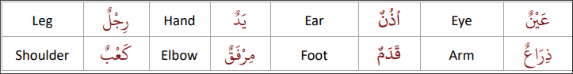
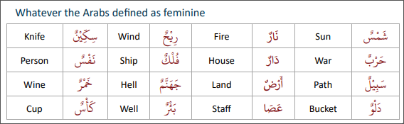

# General Notes

- Nouns are either Feminine or Masculine. Adjectives can be either.
- Adjectives changing to Feminine -> add  َ to letter before and add ة. Always keep tanween for both Feminine or Masculine.
- If not Feminine, then Masculine

# Feminine Nouns

How do identify a Feminine noun:

## 3 Physical Signs:

- ًWords ending with "Ta Marbutah" **ة**
    - السيار<ins>ة</ins>, الطاول<ins>ة</ins>
- Words ending with “Alif Maqsurah” **ى**
    - صغر<ins>ى</ins>, كبر<ins>ى</ins>
- Words ending with “Alif Mamdooda" = "Long Alif Hamzah” **اء**
    - اسم<ins>اء</ins>, سم<ins>اء</ins>, بيض<ins>اء</ins>

## 3 Signs by Meaning

- Feminine by their linguistic meaning/Biological Feminine
    - أم, بنت
    - Female Names: مريم, زينب
- Body parts that come in pairs
    - يد, رجل, عين

- Arabs said so:
    - حرب, دار, ريح, شمس, نار
    - Names of towns and countries

Drills 4-6