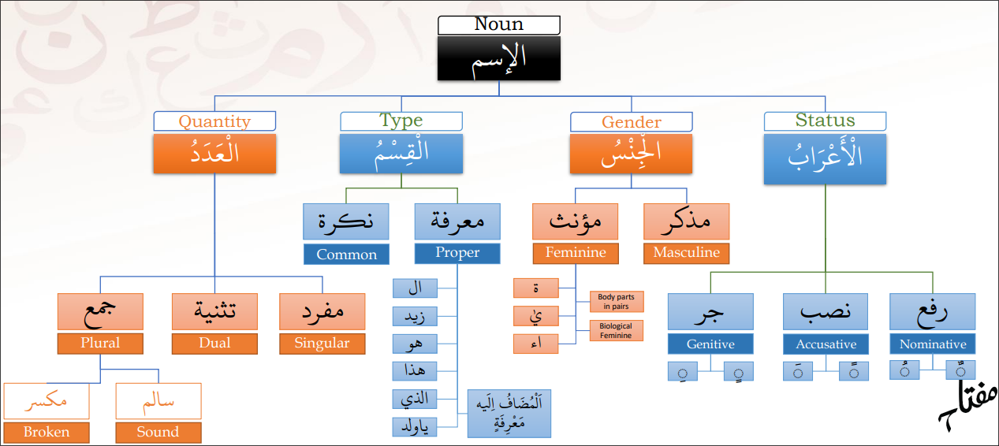

# Charictaristics of a Noun

- مَعْرِفَة / نَكِرَة - Specific/general
- جِنْس - Gender
- اعْرَاب - Status (refers to the Fatha, Damma, or Kasrah)
- عَدَد - Number/quantity

&nbsp;

Every noun is either a proper noun (معرفة) or a general noun (نكرة)

&nbsp;

